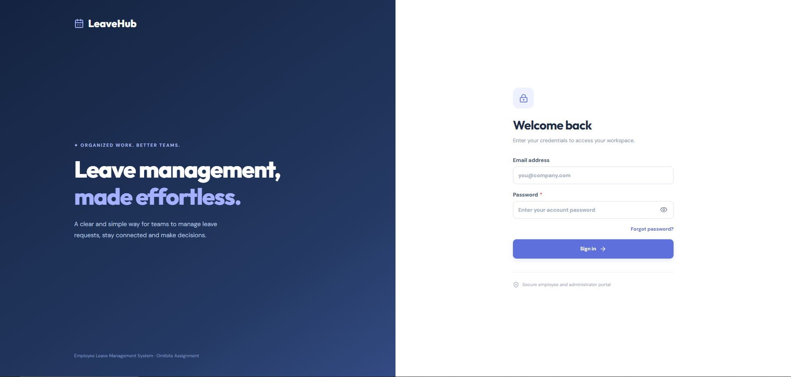
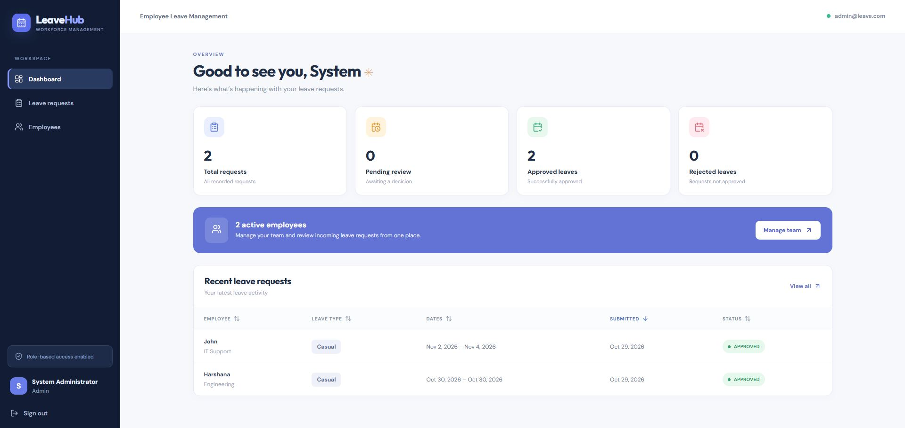
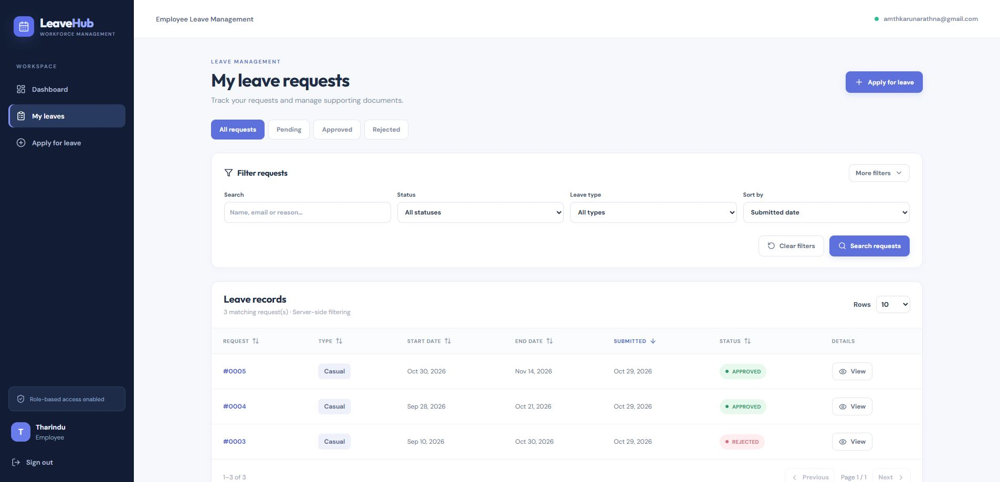
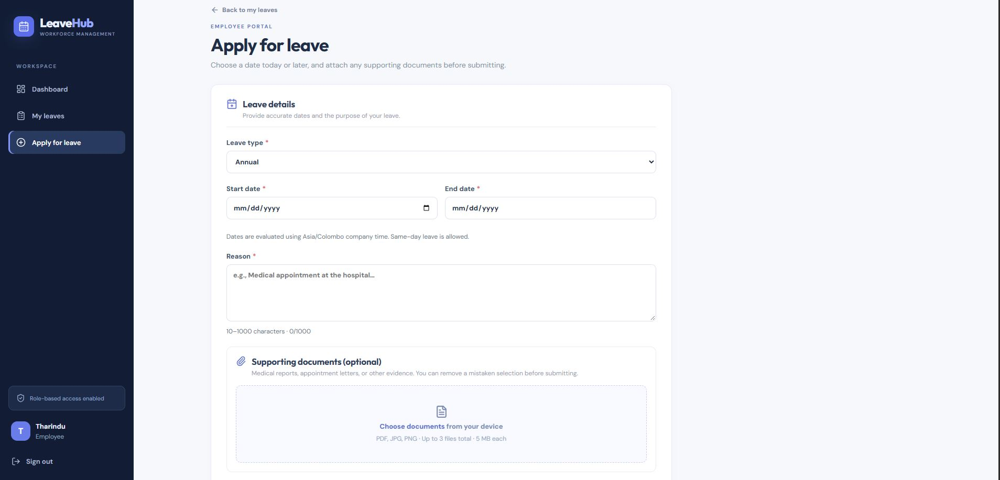
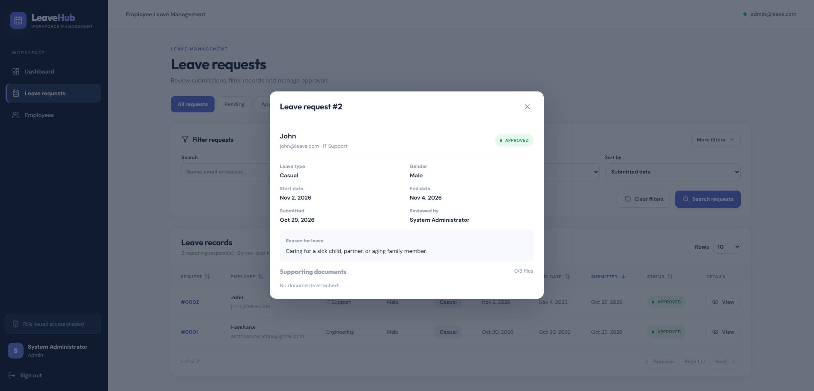

# LeaveHub — Employee Leave Management System

> **Software Engineering Intern Technical Assignment** | Java 21 · Spring Boot 3.5.16 · React 19 · TypeScript · MySQL 8 · Flyway

A full-stack, role-based employee leave management application. Employees can request annual, casual, or medical leave and upload supporting documents. Administrators can review and approve/reject requests, manage employees and departments, and filter records. Super administrators can manage admin accounts. The backend enforces role permissions, validates input, and uses server-side pagination, filtering and sorting.

**GitHub source:** https://github.com/HarshanaLK/leave-management


## Application Screenshots

### Login Page


### Admin Dashboard


### Employee Dashboard


### Apply for Leave


### Leave Approval



### Evaluation quick start

1. Install **JDK 21**, **Maven**, **Node.js 20+ / npm**, and **MySQL Server 8.x**.
2. Create database and application user as described in [Database setup](docs/DATABASE_SETUP.md). Schema migrations are applied automatically by Flyway.
3. Copy `.env.example` to `.env` in the **project root**. Fill in private MySQL credentials and strong initial admin/super-admin credentials (12+ characters). **Never commit `.env`.**
4. In one terminal run `cd backend` then `mvn clean test` and `mvn spring-boot:run`.
5. In a second terminal run `cd frontend`, then `npm ci`, `npm run qa:rules`, and `npm run dev`.
6. Open **http://localhost:5173** and sign in using the admin account from your local `.env`.
7. Browse interactive API documentation at **http://localhost:8080/swagger-ui.html** while the backend is running.

**Reviewer navigation:** [API reference](docs/API_REFERENCE.md) · [Database setup](docs/DATABASE_SETUP.md) · [Interview/demo guide](docs/INTERVIEW_DEMO.md) · [Submission checklist](docs/SUBMISSION_CHECKLIST.md) · [QA report](docs/QA_REPORT.md) · [Security / validation](docs/VALIDATION_GUIDE.md)

**Repository layout:** `backend/` Spring Boot API + Flyway SQL migrations + JUnit tests; `frontend/` React/Vite app + frontend rule tests; `docs/` supporting guides and QA evidence; `scripts/` local start and smoke-test utilities.

**Demo availability:** A live public URL is intentionally not asserted in this README; confirm the current AWS EC2 domain, HTTPS certificate and login behavior before sharing a deployment with reviewers. No real employee data or credentials belong in this repository.

---

## QA revision: leave dates and editable supporting documents

- The **Apply for leave** form rejects dates before the current business day, using **Asia/Colombo** as the company date. Spring Boot independently enforces the rule for direct API requests; this is not only an HTML `min` check. Same-day leave and future ranges are allowed.
- Changing the start date clears an end date that has become invalid. The end-date input is disabled until a start date is selected.
- You can select multiple PDF/JPG/PNG documents, **add more in a later selection**, remove one mistaken document, or clear the selection before submitting. Duplicate selections are ignored; file limits are validated before upload and again on the server.
- Uploaded files can still be downloaded or removed from **My Leaves → View** while the request is **Pending**. Admins can download but not delete them.
- In case a leave was created but some uploads fail, the retry action only resends failed files to avoid duplicates. Remove failed selections if you want to complete without them.
- See [docs/QA_REPORT.md](docs/QA_REPORT.md) for reviewed flows, test cases, security observations, and verification limits.

## What this revision fixes

- **MySQL schema validation**: V2 Flyway migration converts `password_reset_tokens.token_hash` from `CHAR(64)` to `VARCHAR(64)`. Keep V1 untouched so Flyway checksum validation remains consistent.
- **Lazy-loading department bug**: DTO mapping now uses JPA entity getters instead of reading fields directly on uninitialized Hibernate proxies, so an assigned department name is actually loaded. Password reset also updates a managed user rather than writing to an uninitialized proxy.
- **Missing employee departments**: V3 labels legacy `EMPLOYEE` accounts with `NULL department_id` as **Unassigned**, without inventing their department. Admins can edit these accounts and select the real department. Existing department assignments are preserved.
- **Permissions**: New `SUPER_ADMIN` role. Super-admin can create, edit and deactivate `ADMIN` accounts. Existing `ADMIN` still manages employee records and approves/rejects leave. `EMPLOYEE` sees only their own requests. API checks enforce roles, not just the UI.
- **Navigation**: Sidebar `/leaves` link uses exact matching so applying for leave doesn't highlight two links.
- **Sorting**: Click any **data column** header to sort the complete dataset on the **backend**, ascending/descending. Action columns are not sortable. Sorting supports pagination and filters.
- **Department management**: Add a department inside the employee/admin editing dialog.
- **Attachments**: private PDF, JPEG, or PNG files (max 3 files, 5 MB each), available only to the request owner and admins.

## Roles

| Feature                                 | Employee | Admin | Super Admin |
| --------------------------------------- | -------- | ----- | ----------- |
| Create/view own leave, attach reports   | Yes      | No    | No          |
| View all leave requests and attachments | No       | Yes   | Yes         |
| Approve/reject leave                    | No       | Yes   | Yes         |
| Create/edit employees, departments      | No       | Yes   | Yes         |
| Manage additional admins                | No       | No    | Yes         |
| Edit super-admin accounts in UI         | No       | No    | No          |

Super administrator `/admins` page lists **ADMIN** accounts, not the root super-admin account. No user can create additional super-admin accounts through the public API. Keep bootstrap credentials secret.

## Prerequisites (Windows, no Docker)

- Java **JDK 21** (`java -version`)
- Maven **3.6.3+** (`mvn -version`) installed or configured in PATH
- Node.js **20+** and npm (`node -v`, `npm -v`)
- **MySQL Server 8.x**, port 3306, running as a Windows service (`Get-Service *mysql*`)

### 1. MySQL setup

Open MySQL Workbench or an **actual MySQL 8 client** (avoid calling XAMPP's older MariaDB CLI by accident):

```powershell
& "C:\Program Files\MySQL\MySQL Server 8.4\bin\mysql.exe" -u root -p
```

Then execute SQL (change this password to a private strong value):

```sql
CREATE DATABASE IF NOT EXISTS leave_management CHARACTER SET utf8mb4 COLLATE utf8mb4_unicode_ci;
CREATE USER IF NOT EXISTS 'leave_app'@'localhost' IDENTIFIED BY 'YOUR_PRIVATE_DB_PASSWORD';
ALTER USER 'leave_app'@'localhost' IDENTIFIED BY 'YOUR_PRIVATE_DB_PASSWORD';
GRANT ALL PRIVILEGES ON leave_management.* TO 'leave_app'@'localhost';
FLUSH PRIVILEGES;
```

If your MySQL service name is `MySQL84`, launch **Administrator PowerShell** and run `Start-Service MySQL84`. Otherwise check `Get-Service *mysql*` for the correct name.

### 2. Environment

In the root folder **containing** `backend/`, create `.env`:

```powershell
Copy-Item .env.example .env
notepad .env
```

Set `DB_PASSWORD` to your MySQL user's password. Set distinct 12+ character `ADMIN_PASSWORD` and `SUPER_ADMIN_PASSWORD` and real distinct addresses `ADMIN_EMAIL`, `SUPER_ADMIN_EMAIL`. The super-admin can create more admins in the UI.

**Upgrading an older database**: To promote your **existing ADMIN** account without resetting its password, set `SUPER_ADMIN_EMAIL` to exactly that admin's email and give `SUPER_ADMIN_PASSWORD` any secure 12+ character bootstrap value. On startup, the existing admin is promoted and its **original password is retained**. If using a new email, the app creates a new super-admin with the new password. A preexisting employee can never be promoted by this mechanism. On all later runs, existing passwords are not overwritten. Log out and log back in after promotion.

Do **not** commit `.env`. `.env.example` contains placeholders only.

### 3. Start backend

In **terminal 1**:

```powershell
cd backend
mvn clean test
mvn spring-boot:run
```

Flyway migrates the database automatically (V1 on new DBs, V2 and V3 on both new and existing DBs). Do **not** set `spring.jpa.hibernate.ddl-auto=update` as a workaround. The default `validate` detects schema mismatches. Swagger: `http://localhost:8080/swagger-ui.html`.

### 4. Start frontend

In **terminal 2**:

```powershell
cd frontend
npm install
npm run dev
```

Open **http://localhost:5173**. Sign in with the addresses and passwords you configured in `.env`. The Vite proxy forwards `/api` to `http://localhost:8080`.

### 5. Free email sending (optional, no Docker)

Brevo's free plan includes up to **300 sends/day**. The system sends branded HTML + text emails for account creation, leave submission, admin review, approval/rejection, password recovery, and password changes. Free sending requires your own activated Brevo account, verified sender, and SMTP credentials; no real email can be sent until those are set up.

1. Open [docs/EMAIL_SETUP.md](docs/EMAIL_SETUP.md) for illustrated-style step-by-step configuration (no Docker).
2. Configure root `.env` with `MAIL_ENABLED=true`, `MAIL_FROM=verified@your-domain.com`, `SMTP_HOST=smtp-relay.brevo.com`, `SMTP_PORT=587`, `SMTP_USERNAME=<Brevo SMTP login>`, `SMTP_PASSWORD=<Brevo SMTP key>`, `SMTP_AUTH=true`, `SMTP_STARTTLS=true`.
3. Restart backend and go to **SUPER_ADMIN → Email settings → Send test email**.

**Important:** An API response of “queued” is not a delivery receipt. Look for SMTP acceptance/errors in backend logs and verify the inbox. SMTP secrets are never returned to React. For local-only email previews, a locally installed Mailpit SMTP catcher also works without Docker.

### 6. Medical report attachments

Reports are stored in `private-uploads/` outside static web roots. PDF/JPG/PNG, up to 5 MB per file and 3 files per pending request. Owners may upload/delete while pending. Admins/super-admins may download supporting documents from any request. File access is checked by the backend. Do not commit real personal/medical records, or include private upload folders when submitting the project.

## API endpoints

| HTTP      | Path                                                   | Who             | Purpose                             |
| --------- | ------------------------------------------------------ | --------------- | ----------------------------------- |
| GET       | `/api/auth/csrf`                                       | Public          | CSRF token for mutations            |
| POST      | `/api/auth/login`                                      | Public          | Session login                       |
| GET       | `/api/auth/me`                                         | Signed in       | User information and role           |
| POST      | `/api/auth/logout`                                     | Signed in       | Sign out                            |
| POST      | `/api/auth/forgot-password`                            | Public          | Email reset link                    |
| POST      | `/api/auth/reset-password`                             | Public          | Single-use token reset              |
| GET       | `/api/departments`                                     | Signed in       | List departments                    |
| POST      | `/api/departments`                                     | Admin+          | Add department                      |
| GET       | `/api/notifications/status`                            | **Super Admin** | Read SMTP readiness, no secrets     |
| POST      | `/api/notifications/test-email`                        | **Super Admin** | Queue test to own email             |
| GET, POST | `/api/employees`                                       | Admin+          | Filter/list/create employees        |
| PATCH     | `/api/employees/{id}`                                  | Admin+          | Edit employee                       |
| GET, POST | `/api/admins`                                          | **Super Admin** | Filter/list/create ADMINs           |
| PATCH     | `/api/admins/{id}`                                     | **Super Admin** | Edit/deactivate ADMIN               |
| GET       | `/api/leaves`                                          | Signed in       | Own leaves or all leaves for admins |
| GET       | `/api/leaves/stats`                                    | Signed in       | Summary counts                      |
| POST      | `/api/leaves`                                          | Employee        | Submit leave                        |
| PATCH     | `/api/leaves/{id}/approve`                             | Admin+          | Approve pending                     |
| PATCH     | `/api/leaves/{id}/reject`                              | Admin+          | Reject with reason                  |
| GET, POST | `/api/leaves/{id}/attachments`                         | Authorized      | List/upload private file            |
| GET       | `/api/leaves/{id}/attachments/{attachmentId}/download` | Authorized      | Download file                       |
| DELETE    | `/api/leaves/{id}/attachments/{attachmentId}`          | Owner, pending  | Delete file                         |

The React app handles CSRF tokens automatically. For manual API mutation calls, first retrieve a token and include its `X-XSRF-TOKEN` header with the same session cookies.


## Testing / architecture

- Backend: `mvn clean test`
- Frontend business rules: `npm run qa:rules` (9 deterministic checks)
- Frontend TypeScript and build: `npm run build`
- Business rules: invalid dates, rejected/approved terminal states, unauthorized review, invalid sort fields and admin permissions.
- Java feature modules: auth, employees, admin, leaves, department, storage, notification; controllers call services, services call repositories.
- MySQL schema is versioned via Flyway and Hibernate validates mappings.
- Email notifications fire after transaction commit. The simple mail listener logs delivery errors (a persistent outbox with retries is a future improvement).


## Form validation and autofill behavior (updated version)

This version applies matching rules on **both the frontend and Spring Boot backend**. React shows field-specific error text next to invalid fields and the backend returns HTTP `400` with `fields` for invalid JSON DTOs. Backend rules cannot be bypassed by disabling JavaScript.

| Field                             | Rule                                                                                                         |
| --------------------------------- | ------------------------------------------------------------------------------------------------------------ |
| Full name                         | Required; 2–120 characters; letters (including international accents), spaces, periods, apostrophes, hyphens |
| Email                             | Required; standard email format, max 190 characters                                                          |
| Employee/admin initial password   | Required; 8–72 characters; uppercase, lowercase, digit, symbol; no whitespace                                |
| Gender and department             | Required for new employee/admin accounts; department must exist                                              |
| New department                    | Required; 2–100 characters; letters/digits and standard punctuation                                          |
| Leave start/end                   | Required; end date must not precede start date                                                               |
| Leave reason and rejection reason | Required; 10–1000 characters; whitespace padding does not count toward the minimum                           |
| Leave documents                   | Optional; at most 3 per leave, 5 MB each; actual PDF/JPEG/PNG signature checked on the server                |
| Search/filter form                | Search max 120 characters; positive employee IDs; consistent date ranges; validated server-side              |
| Reset password                    | Required; same strength policy as initial passwords; confirmation must match in browser                      |


**Backend checks:** `cd backend; mvn test; mvn spring-boot:run` (requires JDK 21, Maven, MySQL).
**Frontend checks:** `cd frontend; npm install; npm run build; npm run dev` (requires Node 20+).

